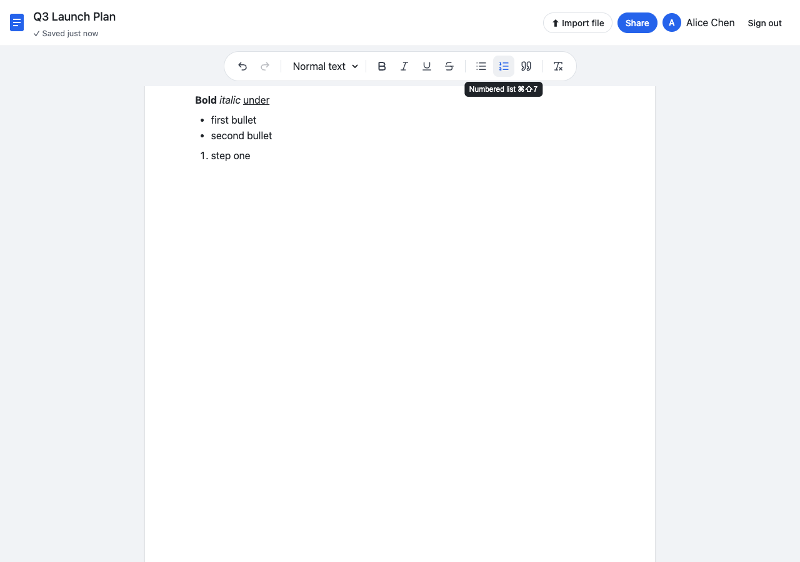

# Ajaia Docs

A lightweight, Google-Docs-inspired collaborative document editor. Create, rename and edit rich-text documents, import `.txt` / `.md` / `.docx` files, and share documents with teammates as **viewer** or **editor**.

> **Live demo:** https://ajaia-docs-74n2.onrender.com (free tier; first load after idling can take 30–60 s)
> **Demo accounts** (password for all: `demo1234`):
> `alice@ajaia.test` · `bob@ajaia.test` · `carol@ajaia.test`
> Alice owns a seeded "Welcome" document that is already shared with Bob as an editor.



## What's included

| Area | Behaviour |
|---|---|
| Documents | Create, rename (inline title), edit, delete; autosave ~0.8 s after you stop typing; `Ctrl/⌘+S` saves immediately |
| Dashboard | Google-Docs-style card grid with live content previews, title search, grid/list toggle (remembered per browser) |
| Formatting | Bold, italic, underline, strikethrough, H1–H3, bulleted & numbered lists, block quote, undo/redo, keyboard shortcuts |
| File upload | **Supported: `.txt`, `.md`, `.docx` up to 2 MB.** Upload from the dashboard to create a new document, or "Import file" inside a document to append to it |
| Sharing | Owner shares with another seeded user as *View only* or *Can edit*; can change role or revoke. Dashboard splits **My documents** / **Shared with me** with role badges |
| Concurrency | Optimistic versioning: if someone else saved first, you get a "newer version exists" banner instead of silently overwriting them |
| Persistence | SQLite (`server/data.db`, created & seeded on first run). Content stored as sanitized HTML |
| Security basics | bcrypt password hashes, signed httpOnly session cookie, server-side HTML sanitization, zod validation, 404 (not 403) for documents you can't see |

## Run locally

Requires **Node 20+** (developed on Node 24).

```bash
npm install
npm run dev
```

- App: <http://localhost:5173> (Vite dev server, proxies `/api` to the server)
- API: <http://localhost:3001>

The SQLite file `server/data.db` is created and seeded automatically. Delete it to reset.

### Production mode (what Render runs)

```bash
npm run build          # builds client/dist
NODE_ENV=production npm start   # Express serves API + built SPA on $PORT (default 3001)
```

### Tests

```bash
npm test        # 20 API tests (Vitest + Supertest, in-memory SQLite)
npm run test:ui # browser smoke test of the full user flow (needs Google Chrome installed + app running on :3999)
```

To run the UI test: `PORT=3999 DATABASE_FILE=/tmp/e2e.db npm start` in one terminal (delete `/tmp/e2e.db` first), then `npm run test:ui` in another. It logs in as all three users, formats a document, imports a file, shares, verifies read-only access, triggers a save conflict and writes screenshots to `e2e/screenshots/`.

### Environment variables

| Var | Default | Notes |
|---|---|---|
| `PORT` | `3001` | |
| `DATABASE_FILE` | `server/data.db` | Use `:memory:` for a throwaway DB |
| `SESSION_SECRET` | dev default | Set in production (Render generates one) |
| `NODE_ENV` | | `production` enables secure cookies + SPA serving |

## Deploy (Render)

`render.yaml` describes a single free web service. Push to GitHub → Render Dashboard → *New → Blueprint* → pick the repo. Build is `npm ci --include=dev && npm run build`, start is `npm start`.

**Known limitation of the free tier:** the disk is ephemeral, so the SQLite file resets whenever the service redeploys or restarts after idling. Seed accounts and the welcome doc are recreated on boot. For durable storage, attach a Render persistent disk (paid) and set `DATABASE_FILE=/data/data.db`, or swap `server/src/db.ts` for Postgres.

## Project layout

```
server/src
  app.ts         Express app factory (used by tests and index.ts)
  db.ts          schema, migrations, seed data
  auth.ts        login/logout/me + requireUser middleware
  access.ts      getRole/assertRole — the single access-control gate
  routes/        documents, shares, uploads
  lib/           sanitize (HTML whitelist), convert (txt/md/docx → HTML)
server/test      API tests + .docx fixture
client/src
  pages/         Login, Dashboard, DocumentPage
  components/    Toolbar, ShareDialog, UploadButton, Header
  useAutosave.ts debounced save + conflict handling
  api.ts         typed fetch wrapper
e2e/             Playwright smoke test
docs/            ARCHITECTURE.md, AI_WORKFLOW.md, screenshots
```

See [docs/ARCHITECTURE.md](docs/ARCHITECTURE.md) for decisions and trade-offs, and [docs/AI_WORKFLOW.md](docs/AI_WORKFLOW.md) for how AI tools were used.

## Scope: what's in, what's out

**Working end to end:** everything in the table above.

**Intentionally not built:** real-time co-editing (cursors, live sync), comments, version history, export, images/tables, public links, self sign-up, search. See the architecture note for why.

**With another 2–4 hours:** Yjs + WebSocket live collaboration (TipTap has first-class support), version snapshots on each save, and `.docx`/PDF export.
